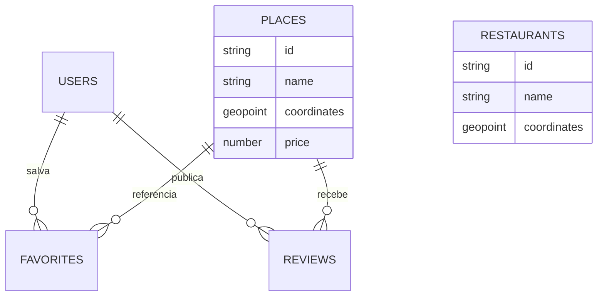

# Organização do backend e banco de dados

A API usa Node.js com Express. O modo de produção persiste dados no Firebase Firestore e o modo demo usa a mesma interface de armazenamento em memória.

## Camadas

- src/config: leitura e validação das variáveis de ambiente.
- src/application: inicialização dos serviços da aplicação.
- src/domains: regras, validações e tipos dos domínios.
- src/database: conexão Firebase, executor e migrations.
- src/app.js: rotas HTTP e casos de uso expostos pela API.
- src/store.js: adaptadores de persistência Firestore e memória.
- scripts: comandos administrativos, seed e migrations.

## Coleções equivalentes às tabelas

- users/{uid}: perfil público do usuário.
- places/{placeId}: ponto turístico e coordenadas.
- places/{placeId}/reviews/{uid}: uma avaliação por usuário e local.
- restaurants/{restaurantId}: restaurante cadastrado.
- users/{uid}/favorites/{placeId}: vínculo de favorito.
- _migrations/{migrationId}: histórico de migrations.
- _meta/schema: versão e descrição do esquema.

Senhas não são gravadas no Firestore. O Firebase Authentication mantém as credenciais, enquanto a coleção users guarda somente nome, e-mail e datas de criação e atualização.

## Migrations

Execute as migrations antes do primeiro uso em um ambiente Firebase:

    npm run migrate

O comando exige DATA_MODE=firebase e credenciais administrativas válidas. Cada migration registra sua execução e pode ser executada novamente sem duplicar dados. Para uma nova alteração, crie outro arquivo numerado em src/database/migrations e adicione-o à lista em src/database/migrate.js.

## Relacionamentos

